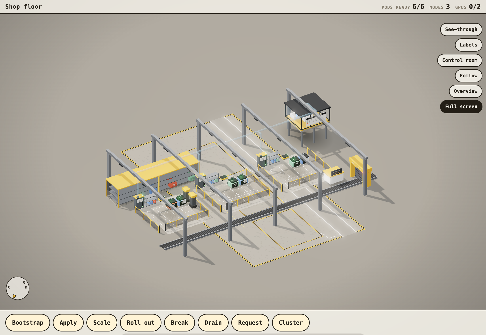

# Kubeshop

[](https://smerwin.github.io/kubeshop/)

An interactive guide to Kubernetes drawn as a job shop, the floor Kubernetes borrowed its words from: pods are machines
running a program, nodes are fenced work cells with their own controller cabinet (the kubelet), tool rack (the image
cache) and AGV (the pull), the scheduler is the dispatcher in the planning office, a binding is a job card blown through a
pneumatic tube to the cell along the same belts (the watch stream; one right of way for control and data), a Service is the sorting station on the conveyor and the Ingress is the
receiving dock. Every button is a real operation played out one true step at a time: bootstrap, apply, scale, roll out,
delete / crash / fail a probe, a dependency cascade (web needs api needs db), GPU scheduling, gang scheduling (a
Volcano-style PodGroup that starts in sync), drain, send a request, and the cluster's security: the CA as a seal press
that stamps a badge for every component and every cell (mutual TLS, kubelet CSRs and rotation), a NetworkPolicy as
gates on the spurs into a job's machines, an inspector at the counter (Pod Security Admission), a forged job card refused
at authentication, Secrets in a locked drawer, signed crates, the logbook as the audit log. Then the networking: the floor's
belts as a small Clos fabric with a diverter (the top-of-rack switch) per row and a two-belt spine (static routes, or BGP announced from every cabinet
with ECMP), kube-proxy's iptables or the CNI's eBPF on the cabinet's switch plate, the directory board at the dock (the kube-dns Service, kept current by the CoreDNS pods) every part
glances at on the way in, a service mesh (escort sidecars, sealed sleeves, the mesh's own CA, a weighted canary) and a managed
control plane behind the provider's fence with a konnectivity relay on every cabinet. Scheduling is instant; what takes time is each cell
pulling its image, one at a time per cell and in parallel across cells, slow from the crib and fast from its own rack.

[](https://smerwin.github.io/kubeshop/?press=Scale>8@900)

**Live:** the figure at <https://smerwin.github.io/kubeshop/> and the guide at
<https://smerwin.github.io/kubeshop/guide.html> (GitHub Pages, built from `main`; on a phone the figure opens full
screen by itself, `?yard=1` forces it). A README can only show pictures of it; click either image to open the real thing.
To run it locally, serve the folder with any static web server (`python3 -m http.server`) and open `index.html` (the
figure) or `guide.html`.

- `index.html` — the figure, so the site opens on it; `guide.html` — the guide: seventeen chapters, each with prose, the
  kubectl commands and the figure preset to that scene (twenty-one with the networking and managed-cluster chapters), and an
  appendix mapping the floor to Kubernetes The Hard Way lab by lab.
- `figure/shopfloor.html` — the same figure beside the earlier drafts: the job shop in three.js with real materials and light (an environment map,
  ACES tone mapping, soft shadows, emissive andon lamps with a bloom pass, a vignette; bloom and resolution step down on
  a device that cannot keep up). It moves like a map (see [Moving around](#moving-around-the-yard)): tap anything to fly
  to it and act on it, names appear as you get closer, See-through, Labels, Follow, and **Control room**: a schematic that
  animates what the control plane does for every operation (the API server pipeline, etcd's Raft group with a leader and
  term, the controllers' informer / queue / reconcile loops, the scheduler cycle, the kubelet sync loop). On a phone it
  opens in **full-screen mode**: the whole screen, nothing scrolls, a toolbar at the thumb. It loads three r186 and a few of its
  addons from `figure/vendor/` through an import map (no build, works offline).
- `figure/longshore3d.html` — the earlier draft: the same cluster as a container terminal (pods are containers, the
  scheduler is a crane) in the hand-inked [Colorfigures](https://april-zhu.com/colorfigures) look; `figure/longshore.html`
  is that yard on the original SVG engine. Both are linked from the footer.
- `src/` — the source: `sim.js` is the cluster model every figure shares (state, controllers, scheduler, the shop's job
  cards and per-node pull queues, the yard's crane, pods, traffic, bootstrap, snapshots, button handlers); `shop3d.js`
  draws the shop floor and `view3d.js` is the camera, gestures, follow, labels and clock it shares with nothing else yet
  (`yard3d.js`, the yard, carries its own older copy); `chrome.js` is the page around a figure (toolbar, sheets, cards,
  chapter sheet) and `room.js` is the control room; `shopfloor.html` and `longshore3d.html` are the pages;
  `longshore.html` + `core.js` are the SVG figure. `./build.sh` inlines the scripts into the `figure/` files.
- `tools/longshore.py` — point the figure at a real cluster (read-only; it only runs `kubectl get`).
- `demo/cluster.json` — a sample snapshot in the yard's format.

## Your own cluster

One snapshot, no server:

```bash
kubectl get nodes,pods,deploy,sts,ds,svc,ingress -A -o json > cluster.json
# open figure/shopfloor.html, then Cluster ▸ "open a kubectl JSON file"
```

Live, refreshed every few seconds (opens http://localhost:8788):

```bash
python3 tools/longshore.py serve --every 5
python3 tools/longshore.py serve -n shop --context prod --port 9000
```

In live mode the figure only watches: the operation buttons show the kubectl command instead of acting. New pods arrive
as job cards and come up from the cell's rack or the crib, deleted pods power down, a cordon puts the tape up, probe
changes switch the andons. System pods (kube-system,
DaemonSets) are hidden until `Cluster ▸ show system pods`.

## Moving around

The camera is a point of interest, a yaw, a pitch and a zoom, and every move is a short flight to a new one. One finger
(or the mouse) orbits; a flick keeps turning and snaps onto the nearest of the four corner views; two fingers pinch to
zoom about the pinch and pan; double-tap zooms in there, a two-finger tap zooms out; ctrl/cmd+wheel (a trackpad pinch)
zooms anywhere, and in full-screen mode a mouse wheel zooms and a trackpad's two fingers pan. Arrow keys orbit, `+` `-` `0`
zoom and reset, `f` is the front view. **Overview** frames the whole floor again; the compass in the corner shows where
the dock (D), the office (O) and the crib (C) are and turns with the camera (tap it for the front view).

Tap a machine, a cell or its cabinet, the office, the sorting station, the dock, the crib or a line on the order board:
the camera flies to frame it and a card opens with its name, state and the actions that make sense there (a pod: logs (the
API server calling the kubelet, drawn in the control room), delete, crash, fail its probe, its containers, restarts, node, ConfigMap, Secret and PVC; a node: drain or uncordon, capacity, GPUs, what is on
its rack and what it is pulling; the station: its endpoints and a request to send; a board line: that app's pods, scale
and roll out). **Follow** keeps the camera on whatever the operation is doing: the job card in the tube, the AGV on its
run, the part on the conveyor, a crashing machine; any gesture releases it. The camera is remembered for the tab, so the
guide's figures do not snap back to the front view.

The **Clock** (next to the counts on a page, a pill among the switches in full screen) runs the whole simulation at 0.1x to
4x, pauses it and steps it 0.1 s at a time; everything simulated follows it (job cards, AGVs, machines, parts, the control
room's messages, how long a toast stays up), while the camera and the page stay in real time. `[` and `]` change the
speed, `space` pauses; `?speed=` sets the start and the choice is remembered for the tab.

Events arrive as **toasts**: a stack of cards, the newest in front and up to three older ones receding behind it, each
one a step higher, smaller and dimmer. The front card always shows its whole text (a step smaller in type if it would
cover more than a third of the screen); only the cards behind it are clipped. A card stays for its simulated span (so
longer at 0.1x), and when the front one expires the next comes forward. Tap the stack to fan the cards out for a moment
and read every older one in full.

Text is a function of zoom, drawn as screen-sized labels over the geometry: at the overview only the node names and the
board's counts; from about two times closer every container's app and version and its GPU band; from about four times
the pod name plates and the board's full rows. They fade between levels and never overlap. With **Labels** on, the
see-through callouts (CONTAINER, POD NETWORK, ETCD, SCHEDULER, ...) are chips you can tap for a short explanation.

**Full-screen mode** (`?yard=1`, or any top-level window narrower than about 900 px, or the `Full screen` switch) gives the canvas
the whole viewport: the page never scrolls, a slim strip on top carries the counts, the actions sit in a thumb-height
toolbar at the bottom and open as sheets, the switches sit in a corner, and the control room and the chapter's prose
slide up as sheets over the floor. In the guide, every chapter's `Open full screen` button opens the figure full screen
with that chapter's parameters, and on a phone the figures open that way instead of embedding.

## Figure URL parameters

All the figures take the same parameters. `?xr=1` see-through, `?labels=1` the callout chips, `?text=0` no name labels,
`?yaw=45&pitch=35` camera, `?press=Scale>5@800,Send@2500` press buttons after load (label, optional `>choice`, `@ms`),
`?boot=1` bootstrap on load, `?web=5` / `?v2=1` / `?cache=1` / `?train=1` / `?spark=1` / `?cordon=node-a` / `?netpol=1` (the
db-from-api NetworkPolicy in force) starting state, `?press=Break>forge@800` / `Break>apply a privileged@800` /
`Break>let node-b@800` / `Apply>NetworkPolicy@800` the security breaks, `?press=Break>cut@800` node-b's uplink cut (NotReady after 40 s, eviction after 300 more; `?speed=4` hurries it), `?fabric=bgp` the BGP fabric, `?svc=ebpf` eBPF Service
addressing, `?mesh=1` the mesh installed, `?canary=10` a 10% canary (installs the mesh), `?managed=1` the managed control plane,
`?press=Break>stop CoreDNS@800` the directory board blank,
`?cluster=URL&poll=5` watch a snapshot URL, `?speed=4` run the simulation faster, `?pal=cobalt` the trim colour (the office,
the crib and the dock; the crane and tower in the yard). The three.js figures also take `?room=1` to open the control room, `?yard=1` (or `?yard=0`) for yard mode, and
`?chapter=scale` to load that guide chapter's prose into the chapter sheet and play its camera move (frame the thing it
is about, or follow the operation it presses).

## The control room

`Control room` draws the control plane as boxes and plays every yard operation through them as messages:
`kubectl` into the API server pipeline (authentication, authorization, mutating admission, validating admission, schema
validation, the write), etcd as a three-member Raft group (the leader proposes and appends, replicates, a quorum
acknowledges, commit, apply; the watch streams fan out from the applied log; the term is shown), the controllers as loops
(informer cache, work queue, reconcile, a write back: Deployment, then ReplicaSet, then Pod), the scheduler cycle
(filter: room, GPU, cordon, gang; score: spread; bind) and the kubelet on the bound node (watch, CRI pull and start,
probes, status). `Break ▸ stop an etcd follower` changes nothing (the quorum holds); `Break ▸ stop the etcd leader` runs an
election: the term goes up, writes wait at the API server, then go through once a new leader is elected. Every bead wears a
TLS tag (mutual TLS between components); the controller manager's CA box signs each kubelet's CSR at join and at rotation;
a forged request dies in red at authentication and a privileged pod at validating admission (Pod Security); the log panel
is labelled as the audit log.
