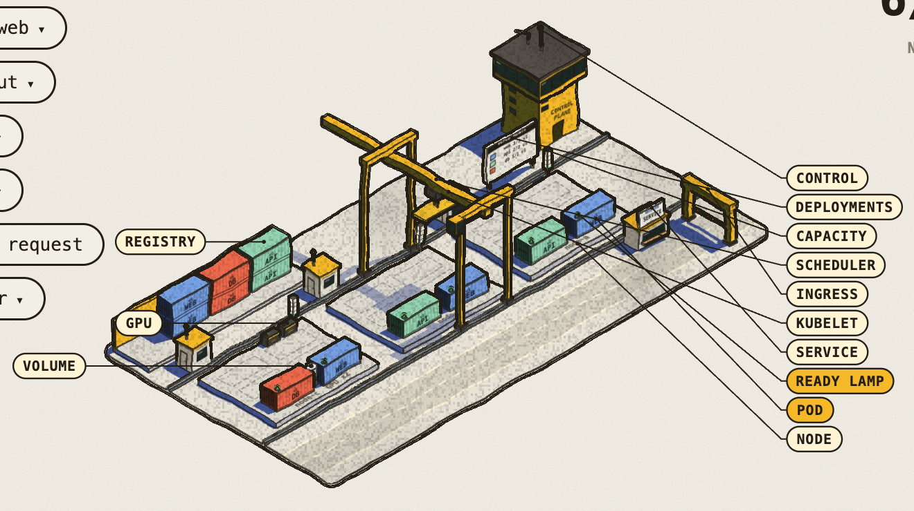
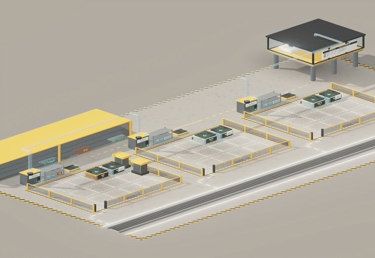

# Longshore

[](figure/longshore3d.html)

An illustrated, interactive guide to Kubernetes drawn as a shipping-container terminal: pods are 20-foot containers,
nodes are concrete docks with a kubelet booth, the scheduler is a gantry crane, the control plane is the harbour tower,
a Service is the kiosk and the Ingress is the gate. Every button is a real operation played out one true step at a time:
bootstrap, apply, scale, roll out, delete / crash / fail a probe, a dependency cascade (web needs api needs db), GPU
scheduling, gang scheduling (a Volcano-style PodGroup that lands by parachute), drain, send a request.



The figure itself is a web page, so a README can only show pictures of it. To run it, open `index.html` (the guide) or
`figure/longshore3d.html` from a local web server, or push the repository to GitHub and turn on GitHub Pages for the
default branch: the guide then lives at `https://<you>.github.io/longshore/` and the figure at
`https://<you>.github.io/longshore/figure/longshore3d.html`, which is what these two images should link to.

- `index.html` — the guide: sixteen chapters, each with prose, the kubectl commands and the figure preset to that scene.
- `figure/longshore3d.html` — the figure: the yard in three.js with real depth, drawn in the hand-inked
  [Colorfigures](https://april-zhu.com/colorfigures) look (flat tone bands, an ink pass, a flat blue shadow, paper grain).
  Drag to turn it all the way round, pinch or ctrl+wheel to zoom, See-through, Labels, and **Control room**: a schematic
  under the yard that animates what the control plane does for every operation (the API server pipeline, etcd's Raft
  group with a leader and term, the controllers' informer / queue / reconcile loops, the scheduler cycle, the kubelet
  sync loop). It loads three r186 from `figure/vendor/` (no build, works offline).
- `figure/longshore.html` — the same yard on the original Colorfigures SVG engine (the old engine), kept as a fallback.
- `src/` — the source: `sim.js` is the cluster model both figures share (state, controllers, scheduler, crane, pods,
  traffic, bootstrap, snapshots, button handlers); `yard3d.js` draws it in three.js and `room.js` is the control room
  (`longshore3d.html` is their page); `longshore.html` + `core.js` are the SVG figure. `./build.sh` inlines the scripts
  into both `figure/` files.
- `tools/longshore.py` — point the figure at a real cluster (read-only; it only runs `kubectl get`).
- `demo/cluster.json` — a sample snapshot in the yard's format.

## Your own cluster

One snapshot, no server:

```bash
kubectl get nodes,pods,deploy,sts,ds,svc,ingress -A -o json > cluster.json
# open figure/longshore3d.html, then Cluster ▸ "open a kubectl JSON file"
```

Live, refreshed every few seconds (opens http://localhost:8788):

```bash
python3 tools/longshore.py serve --every 5
python3 tools/longshore.py serve -n shop --context prod --port 9000
```

In live mode the yard only watches: the operation buttons show the kubectl command instead of acting. New pods arrive by
crane, deleted pods fade, a cordon puts the striped tape up, probe changes switch the lamps. System pods (kube-system,
DaemonSets) are hidden until `Cluster ▸ show system pods`.

## Figure URL parameters

Both figures take the same parameters. `?xr=1` see-through, `?labels=1` labels, `?yaw=45&pitch=35` camera,
`?press=Scale>5@800,Send@2500` press buttons after load (label, optional `>choice`, `@ms`), `?boot=1` bootstrap on load,
`?web=5` / `?v2=1` / `?cache=1` / `?train=1` / `?spark=1` / `?cordon=node-a` starting state, `?cluster=URL&poll=5` watch a
snapshot URL, `?speed=4` run the simulation faster, `?pal=cobalt` the crane and tower colour. The three.js figure also
takes `?room=1` to open the control room.

## The control room

Under the yard, `Control room` draws the control plane as boxes and plays every yard operation through them as messages:
`kubectl` into the API server pipeline (authentication, authorization, mutating admission, validating admission, schema
validation, the write), etcd as a three-member Raft group (the leader proposes and appends, replicates, a quorum
acknowledges, commit, apply; the watch streams fan out from the applied log; the term is shown), the controllers as loops
(informer cache, work queue, reconcile, a write back: Deployment, then ReplicaSet, then Pod), the scheduler cycle
(filter: room, GPU, cordon, gang; score: spread; bind) and the kubelet on the bound node (watch, CRI pull and start,
probes, status). `Break ▸ stop an etcd follower` changes nothing (the quorum holds); `Break ▸ stop the etcd leader` runs an
election: the term goes up, writes wait at the API server, then go through once a new leader is elected.
